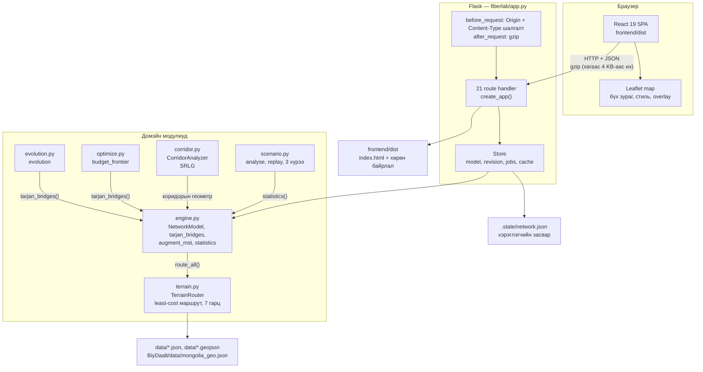
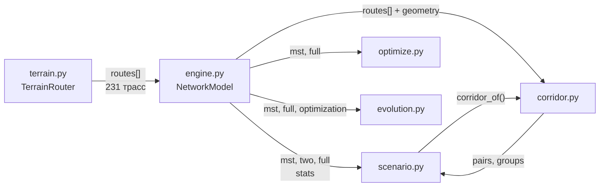
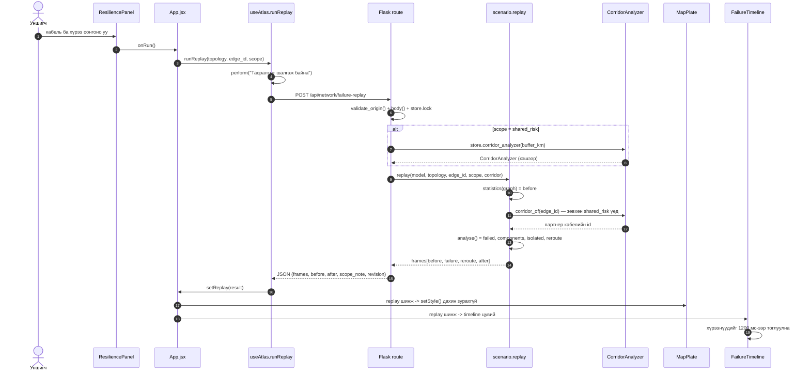
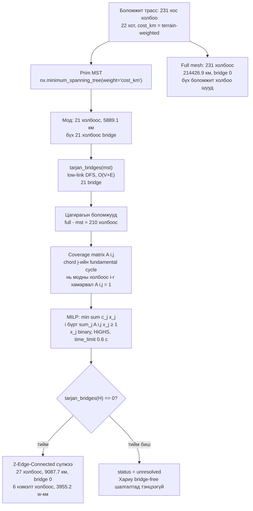
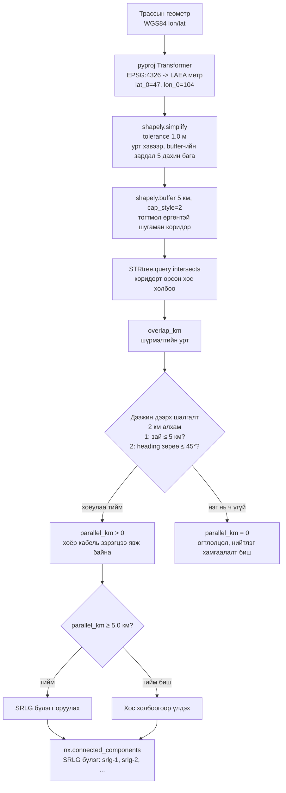
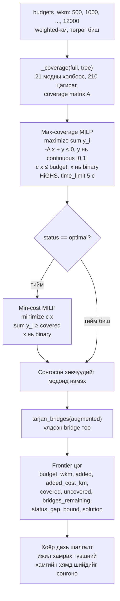
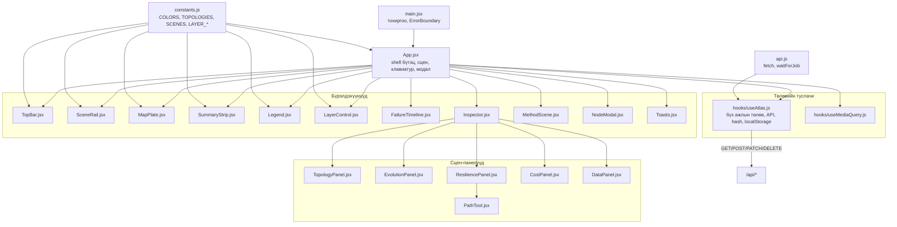

# Fiber Atlas — архитектур

> National Network Resilience Studio · Python 3.12 / Flask 3.1 + NetworkX 3.7 + SciPy 1.18 (HiGHS) + Shapely 2.2 / pyproj дээрх сервер; React 19 + Tailwind v4 + Leaflet 1.9 дээрх интерфейс.

Энэ бичиг системийн **бүтэц**, **өгөгдлийн урсгал**, **хэмжээ** байг. Диаграм нь Mermaid кодоор бичигдсэн тул GitHub дээр шууд харагдана. Бүх хугацааны тоо энэ машины дээр **заавар хэмжсэн** утга бөгөөд хэмжээлүүдийн арга нь §7-д дурдсан.

---

## 1. Системийн ерөнхий бүтэц

Систем нь **нэг процесс**. Flask API, домэйн модулиуд, статик React бүлэг нэг origin дээр (`http://127.0.0.1:5080`) ажиллана. Интернэт шаардлагатай: офлайн рельеф дүрс (`frontend/public/relief.webp`) болон `data/routes.cache.json` локал байдаг; зөвхөн OSM/CARTO/OpenTopoMap tile давхаргууд сонгогдсон үед сүлжээний шаардлагатай бөгөөд тэдгээр ажиллахгүй бол офлайн рельеф рүү автоматаар шилжинэ (`MapPlate.jsx`, `onTileFailure`).



**Дүрэм.** `app.py` нь зөвхөн **HTTP хязгаар** юм. Бүх тооцоо (`engine`, `scenario`, `corridor`, `optimize`, `evolution`) домэйн модулиудад байгаа бөгөөд `app.py` тэдгээрийг зөвхөн дуудаж, JSON-аар буцаана. Энэ нь UI-ийн логикийг сервертэй хамт өөрчлөх боломжгүй болгоно.

**Нэг процесс, нэг түлхүүр.** `Store` нь `threading.RLock`-тэй. Бүх `/api/network/*` болон `/api/nodes*`, `/api/edges*` handler `with store.lock:` блок дотор ажиллана. Онцгойлон `/api/network/corridors?topology=full` нь **3.4–7.1 секунд** хугацаа авдаг тул түүнийг уншигч түлхүүрээр удирдахгүй байх нь зайлшгүй (§7.4).

---

## 2. Домэйн модулиудын харилцаа



| Модуль | Хариуцдаг зүйл | Гол API |
|---|---|---|
| `fiberlab/terrain.py` | Рельефийн тор (5 км алхам, LAEA метр проекц), саадыг тойрсон least-cost маршрут, 7 төлөвлөсөн голын гарц, уулын нэвтрэх хэсэг | `TerrainRouter.route_all(cities)`, `.layers()`, `.fingerprint(cities)` |
| `fiberlab/engine.py` | Prim MST, Tarjan bridge, бинар set cover MILP, статистик, payload | `NetworkModel(cities, routes, excluded, overrides)`, `tarjan_bridges`, `augment_mst`, `statistics` |
| `fiberlab/scenario.py` | Тасралтын гурван хүрээ, хэсэгт салгасан хотын тоо, нөөц зам, **хугацааны шугамын хүрээнүүд** | `analyse(...)`, `replay(...)`, `SCOPE_LABELS` |
| `fiberlab/corridor.py` | Проекцласан метр зангилаанд SRLG: буфер, давхцол, чиглэлийн тест, бүлэглэл | `CorridorAnalyzer(routes, buffer_km)`, `.overlaps()`, `.groups()`, `.corridor_of()`, `.impact()` |
| `fiberlab/optimize.py` | Төсөвийн фронт: maximum coverage under budget, Pareto цэгүүд | `budget_frontier(full, tree, budgets)`, `cheapest_cover`, `pareto` |
| `fiberlab/evolution.py` | Байгуулалтын таван шат (бүгэлд алгоритмын үр дүнгээс **уншигдана**) | `evolution(model)` |

---

## 3. Тасралтын хугацааны шугам: дарааллын диаграм

Доорх дараалал нь `ResiliencePanel` → `useAtlas.runReplay` → `/api/network/failure-replay` → `scenario.replay` → timeline-ийн тоглуулалтын бодит урсгал юм.



**Хүрээнүүдийн бүтэц** (`scenario.replay`):

| Хүрээ | `failed_edges` | `reroute` | `metrics` |
|---|---|---|---|
| `before` | `[]` | `[]` | connected, component_count, isolated, rtt_ms, bridge_count |
| `failure` | тасарсан холбоосууд | `[]` | connected, component_count, isolated, rtt_ms=null |
| `reroute` | тасарсан холбоосууд | нөөц зам | + `delta_rtt_ms` (өмнөх хугацааны ялгавар) |
| `after` | тасарсан холбоосууд | нөөц зам | connected, component_count, isolated, rtt_ms, bridge_count |

`reroute` хүрээ нь зөвхөн нөөц зам олдсон үед үүснэ; эс бөгөөс хоёр хүрээ (`before`, `failure`, `after`) байна.

**Нэг чухал нөхцөл.** Хүрээ бүрийн тоо нь **серверийн тооцооноос** гарна: `statistics()` нь `nx.is_connected`, `nx.all_pairs_dijkstra_path_length`, `tarjan_bridges` ашиглана. Timeline-ийн бичиглэл (`f"{before['edges']} кабель бүх хот холбогдсон. Bridge: {before['bridge_count']}."`) нь скрипт биш, тооцооны дүгнэлт юм. Тиймээс timeline-ийг «анимац» гэж нэрлэх боломжгүй — энэ нь **бодит төлөвийн дараалал** юм.

**Нэг зүйлийг дүгнэлтээр тэмдэглэе.** Хугацааны шугамын хүрээ бүр өөрийн `failed_edges`/`reroute_edges` жагсаалттай, гэхдээ `FailureTimeline.jsx` нь **одоогийн хүрээг карт руу буцааж илгээдэггүй** — `replay` объектыг App-оос авдаг. Иймээс плат нь шинжилгээний **эцсийн** төлөвийг (бүх тасарсан холбоос + нөөц зам) бүх хугацааны шугамын турш харуулна; хугацааны шугам нь хүрээний **гарчиг, тайлбар, бөөн хүрээний төлөвийг** тоглуулна. Энэ нь одоогийн хэрэглээлтийн төлөв бөгөөд цаашид хүрээ тус бүрийг тус тусад нь дүрслэх боломжтой.

---

## 4. Топологийн байгуулалтын урсгал



**Тоонууд** (`/api/network/evolution`-ийн таван шат, бүгжээс уншигдсан):

| Шат | Тоо | Эх сурвалж |
|---|---|---|
| `candidates` | 231 боломжит хос холбоо, 214,426.9 км | `model.full` |
| `mst` | 21 холбоос, 5,889.1 км, 7,284.1 w-км | `nx.minimum_spanning_tree` |
| `bridges` | 21 bridge | `tarjan_bridges(mst)` |
| `chords` | 210 боломжит цагираг, 6 сонгосон | `full - mst`, `optimization['added']` |
| `protected` | 27 холбоос, 9,087.7 км, 54.31% нэмэлт, bridge 0 | MILP-ийн шийд |

**Тэмдэглэл.** Энэ бүхэл урсгал нь **нэг** `NetworkModel` дүүрэлтээс гарна (`engine.py`). Тиймээс энэ таван шат нь зөвхөн нэг тооцооны дүрслэл бөгөөд тус тусад нь бодогдоогүй: эерэг нь `optimization['added_cost_km']` нь `optimization['gap'] == 0.0` буюу HiGHS шийд бүрэн баталгаажуулсан гэдгийг харуулна.

**Хязгаарлалт.** Энэ нь **тогтсон нэг Prim MST-ийн** олонлгох. Өөр мод сонговол хямд цагираг өөр бөгөөд зардал бага байж болно. Энэ нь код дотор бичигдсэн: `optimization['global_2ec_optimum'] = False`, `optimization['scope'] = 'Fixed Prim MST augmentation; candidate terrain grid routes'`.

---

## 5. Коридорын нийтлэг хамгаалалтын шинжилгээ



**Тогтмол параметрүүд** (`corridor.CORRIDOR_POLICY`):

| Параметр | Утга | Учир |
|---|---|---|
| `PROJECTION` | `+proj=laea +lat_0=47 +lon_0=104 +datum=WGS84 +units=m` | Тойрнын төвд тохируулсан тэнцэтгэлд дээр тохиромжтой — уртыг алдахгүй |
| `buffer_km` | 5.0 | Коридорын өргөн |
| `min_parallel_km` | 5.0 | Энээс давсан зэрэгцээ урттай хосыг л SRLG-д оруулна |
| `parallel_angle_deg` | 45.0 | Чиглэлийн зөрөөний дээд хязгаар |
| `SAMPLE_KM` | 2.0 | Дээжийн алхам |
| `VERTEX_TOLERANCE_M` | 1.0 | Нэг төгсгөлөөс цэвэрлэх тэлэв (уртыг өөрчлөхгүй) |

**Одоогийн үр дүн** (protected топологи, 27 холбоос, өргөн 5 км):

| Үзүүлэлт | Утга |
|---|---|
| SRLG бүлэг | 2 (`srlg-1`: 20 кабель, 1263.0 км; `srlg-2`: 4 кабель, 180.6 км) |
| Нийт зэрэгцээ урт | 1480.2 км |
| Бүлэгт ороогүй кабель | 3 (27-ийн дотроос) |

**Чиглэлийн тест яагаад шаардлагатай вэ?** Хоёр кабель бие биенээ хүрэх нь гурван ялгаатай шалтгаантай байж болно: (а) нэг суваг дагуу зэрэгцээ явж байна; (б) нэг голын гарцад огтлолцож байна; (в) нэг уулын дээгүүрээр дайрч байна. Зөвхөн (а)-д нэг шахал хоёр кабелийг хамт унагана. Тиймээс ойртолцлыг хангалтгүй гэж үзэж болохгүй: огтлолцлын тохиолдолд `parallel_km` нь **байгуулалтаар 0** байх ёстой. Иймээс `parallel_km`-г `min(parallel_km, overlap_km)`-ээр хязгаардаж, SRLG бүлгийн босгыг (`min_parallel_km = 5.0`) зөвхөн зэрэгцээ уртаар тогтооно.

**Тэгвэл яагаад энэ бүхэл «зэрэгцээ урт» нь ойролцоо биш бөгөөд чиглэлтэй?** Учир нь ойртолцоо нь **үр дүн** биш, **үрсэл** юм. Ойртолцоо нь «эдгээр хоёр кабель хэтэрхий дээр байна» гэсэн дотоод тайлбар бөгөөд инженерийн хувьд хэрэгтэй нөхцөл биш. Харин «эдгээр хоёр кабель нэг суваг дагуу зэрэгцээ явж байна» нь нөхцөл бөгөөд шууд ажилд хэрэгтэй. Энэ нь код дотор бичигдсэн: `CORRIDOR_POLICY['method']` бүх хэмжээг, `limitations` бүх хязгаарыг нэрлэдэг.

---

## 6. Төсөвийн фронтын MILP



**Хоёр шатлалт MILP-ийн үндэслэл.** Эхний шат (max-coverage) нь «төсөвөөр хамгийн олон модны холбоосыг хамгаалах» багцыг олно. Гэхдээ энэ нь **үр дүн**, **зардал** биш. Иймээс `optimal` төлөвтэй үед хоёр дахь шат (min-cost) ажиллаж, **яг адил хамрах түвшний** шийдүүдээс хамгийн хямдыг сонгоно. Тэгэхгүй бол фронт нь ижил тэсвэрийн хувьд дурын нэг өртгийг харуулж, тэнцэтгэл биш болно.

**`y` хувьсагчийн тухай чухал нарийн дээр.** `y_i` нь continuous (`integrality = 0`), харин `x_j` нь binary. Хязгаар `-A x + y ≤ 0` тул `y_i` нь зөвхөн `A x` дээр тэгээс их үед 1 хүртэл өснө. Иймээс зорилго `sum y_i` нь **хос холбоос-ирмэгийн тоо** биш, **ялгаатай хамгаалагдсан модны холбоосын тоо** юм. Энэ нь `optimize._max_coverage_model`-ийн docstring-д бичигдсэн.

**`bound` талбар.** HiGHS-ийн `mip_dual_bound`-оос гарна: minimum-cost бодлогод энэ нь **доод хязгаар**, budget бодлогод **хамгаалагдсан холбоосын дээд хязгаар**. `gap` нь HiGHS-ийн харьцсан MIP gap; primal шийд байхгүй бол `inf` (эсвэл `None`) — худал тоо гаргахгүй.

---

## 7. API-ийн гадаргуа ба хэмжсэн хугацаа

### 7.1 Хэмжээлүүдийн арга

- **Хэрэгсэл:** Flask test client (`app.test_client()`), `create_app(persist=False)`.
- **Орчин:** Python 3.12.14, NetworkX 3.7, SciPy 1.18.1, Shapely 2.2.0, Flask 3.1.3. Нэг процесс, нэг thread, сүлжээгүй.
- **Процедур.** Эхний дуусалтын хугацаа (**cold**) нь шинэ процесс дээрх эхний дуусалт. Дараа нь **бүх endpoint-ийг** дахин дахин, нийт **3 удаа**, давталта бүрт **7 дуусалт** хийж, «Typical» гэдэгт **давталт бүрийн медианы медианыг** бичвэл. Энэ нь нэг бүрэлдэхүүний жижиг дурын саат (GC, OS-ийн scheduler)-ыг хасах хамгийн тогтвортой үнэлгээ.
- **Энэ нь серверийн тооцоо + сериализацийн хугацаа.** Сүлжээний дамжуулалт, браузерийн JSON уншилт, Leaflet-ийн зураглал — эдгээр **энд ороогүй**. Мөн test client `Accept-Encoding: gzip`-ийг тохирохгүй тул gzip дарах хугацаа ч ороогүй; gzip нь зөвхөн `Accept-Encoding` нь gzip-ийг агуулсан үед, 4096 байтаас их хариунд дээр хэрэглэгдэхээр зөвшөөрөгдсөн (`app.py`, `after_request`).
- **Машин ачааллын нөлөө.** Хэмжээлүүдийг авсан үед нэг орчинд өөр ажил ажиллаж байсан (12 цөв дээр load average ≈ 2.0). Тиймээс **хүйтэн** машинын үед дээрх бүх хэмжээг дахин хэмжсэн бөгөөд solver-тэй холбоо бүхий endpoint-үүд **ойролцоогоор хоёр дахин** удаан гарсан. §7.2-д аль ч тоо **үргэлж дээрхь дүрэмээр** (бүх endpoint-ийг 3×7 удаа, дээрх аргаар) хэмжсэн; хоёр тогтмолын ялгааг §7.3-ын төгсгөлд тус тусад нь үзүүлэв.
- **Мөн хэмжээгдээгүй:** реаль хэрэглэгчийн браузер, сүлжээний саат, CPU-ийн хэмжээ, I/O. Эдгээрийн талаар **өгүүлбэр байхгүй**.

### 7.2 Хүснэгт

| Method & Path | Юу тооцдог | Cold (мс) | Typical (мс) | Хариуны хэмжээ |
|---|---|---:|---:|---:|
| `GET /api/health` | `store.busy`, `store.revision` | 0.63 | **0.26** | 70 B |
| `GET /api/network/topologies` | `NetworkModel.payload()`: хот, 231 трассын metadata, 3 топологийн stats, `optimization`, `assumptions` | 4.72 | **3.88** | 141,072 B (gzip 19,527) |
| `GET /api/network/geometry?topology=mst` | MST-ийн 21 холбоосын vertex жагсаалт | 1.53 | **1.44** | 36,231 B (gzip 16,213) |
| `GET /api/network/geometry?topology=protected` | 27 холбоосын vertex жагсаалт | 2.08 | **2.05** | 56,143 B (gzip 23,237) |
| `GET /api/network/geometry?topology=full` | 231 холбоосын vertex жагсаалт | 42.55 | **41.84** | 1,386,014 B (gzip 364,238) |
| `GET /api/network/evolution` | Байгуулалтын таван шат, Prim-ийн дараалал, bridge-ийн хуваарийн, chord-ын cycle-үүд, coverage map | 7.66 | **7.03** | 103,446 B (gzip 14,641) |
| `GET /api/network/corridors?topology=protected` | SRLG хос, бүлэг, coverage, policy | 490 | **0.8** | 21 KB |
| `GET /api/network/corridors?topology=full` | 231 холбоос дээрх бүх хос (хамгийн их 60 хос буцаана) | **7,583** | **0.9** | 27 KB |
| `GET /api/network/audit` | 3 топологийн **кабель бүрийг** тасаж холбоотой үлдэхээг шалгах | 121.06 | **0.46** | 13,820 B (gzip 1,235) |
| `GET /api/geography` | Давхаргуудын GeoJSON (59 feature: 1 хил, 22 аймаг, 14 нуур, 7 гол, 4 уул, 4 ой, 7 гарц) | 0.78 | **0.55** | 171,708 B (gzip 53,640) |
| `GET /api/export/geojson?topology=` | Топологийн LineString + хотын Point | 2.80 | **2.47** | 73,033 B |
| `GET /api/export/csv?topology=` | `u, v, distance_km, cost_weighted_km, detour_pct, mountain_access_km` | 0.54 | **0.40** | 2,342 B |
| `GET /api/export/json?topology=` | `model.payload()` | 4.46 | **3.87** | 149,504 B |
| `POST /api/network/failure-replay` | `scenario.replay`: before/failure/reroute/after хүрээнүүд | 3.15 | **2.42** | 4,883 B |
| `POST /api/network/simulate-cut` | `scenario.analyse` (хүрээгүй) | 1.67 | **1.55** | 1,734 B |
| `POST /api/network/path` | Жинтэй хамгийн богино зам, тасарсан холбоосыг дайрахгүйгээр | 0.69 | **0.61** | 310 B (UB → Khovd; зам уртаас хамаарна) |
| `POST /api/network/impact` | Радиустай огтлолцсон кабель + SRLG-ээс урсгалт correlated | 2.45 | **2.17** | 4,702 B |
| `POST /api/network/optimize` (8 төсөв) | 8 төсөвийн фронт (max-coverage + min-cost) | 55.92 | **394–406** | 8,822 B |
| `POST /api/network/optimize` (1 төсөв) | Нэг төсөвийн фронт цэг | 55.92 | **56–60** | 928 B |
| `GET /api/jobs/<job_id>` | Дор ажлын төлөв | 0.28 | **0.28** | — (байхгүй бол 404) |
| `POST /api/nodes` | Зангилаа нэмэх → **background job**: бүх хосыг дахин маршрутжуулна | **1.14** (диспэтч) | ажил **7,588 мс** | 202 + job_id |
| `PATCH /api/nodes/<key>` | Зангилаа засах → background job (fingerprint өөрчлөгдөхгүй бол маршрут дахин тооцдохгүй) | **5.69** (диспэтч) | ажил **361 мс** | 202 + job_id |
| `DELETE /api/nodes/<key>` | Зангилаа хасах → `NetworkModel`-ыг дахин боснох (синхрон) | **≈28** | **≈28** | 200 (12 B) |
| `POST /api/edges/<id>` | Трассыг боломжит сангаас буцааж оруулах | **28.31** | **28.31** | 200 (12 B) |
| `PATCH /api/edges/<id>` | `cost_factor`-ыг өөрчлөх → `NetworkModel` дахин боснох (Prim + MILP) | **34.70** | **29.23** | 200 (12 B) |
| `DELETE /api/edges/<id>` | Трассыг боломжит сангаас хасах | **32.29** | **32.29** | 200 (12 B) |
| `POST /api/network/reset` | Анхны 22 хотын төлөвт буцаах | **29.61** | **29.66** | 200 (12 B) |
| `GET /` | `frontend/dist/index.html` | 0.50 | **0.50** | 698 B |
| `GET /<path:path>` | Статик хөрөн байрлал (`frontend/dist`) | — | — | — |

### 7.3 Задалд анхаарах өргөмж

**А. Хамгийн удаан тооцоо нь `corridors?topology=full` — 7.6 секунд.** Энэ нь 231 холбоос дээрх бүх 14 597 хосыг шалгаж, `parallel_km`-ийн дээжийг авах үйлдэл. Тиймээс:

- **Хариу кэшээрдэнэ.** `Store.corridor_result(topology, buffer)` нь тооцоолсон үр дүнг хадгална; дараагийн дуусалт **0.9 мс**.
- **Ажиллаж буй үед нь урьдчилан тооцогдоно.** `create_app()` нь `mst`, `protected`, `full` гурвыг daemon thread-ээр урьдчилан бодно. Иймээс **уншигч хэзээ ч 7 секунд хүлээхгүй** — хүйтэн зардал серверийн ачаалалд бүртгэгдэнэ, хариу үргэлж warm.
- **Хариу хэмжээ хязгаарлагдсан.** Бүх 14 597 хос буцаасаны оронд зэрэгцээх уртаар эрэмбэлсэн **хамгийн их 60 хос** буцаж, нийт тоо `pair_count`-д байна. Иймээс full mesh-ийн хариу 27 KB, 2.4 MB биш.
- `useAtlas.js` нь үүнийг зөвхөн `scene === 'resilience'` үед л дуудана.

**Б. `audit` нь 121 мс, гэхдээ дараагийн дуусалт 0.46 мс.** Учир нь `store.audit_cache` нь `save()`-д цэвэрлэгдэж, эхний дуусалтаар л **279 кабелийг** (21 + 27 + 231, хэмжсэн) тус бүр нэг нэгээр тасаж шалгадаг. Энэ нь **зориулан хүнд** үйлдэл — бүх кабелийн гэмтлийг шалгах нь «дээд мөрөөс нэг товч» дараах бүх жижиг кабелийг дайрах.

**В. `optimize` нь төсөвийн тоонд шугаман.** 1 төсөв = 56–60 мс, 8 төсөв = 394–406 мс. Өөрөөр хэлбэл **төсөв бүр ~50 мс** (хоёр MILP бодлого тус бүр). `CostPanel` нь 8 төсөв + хэрэглэгчийн оруулсан нэг төсөвийг нэгэнд нийлдэг. Энэ нь хамгийн удаан, гэхдээ хэрэглэгчийн **нэгэнт** өгдөг үйлдэл.

**Г. Засварын endpoint-ууд ≈28–32 мс** — энэ нь `NetworkModel`-ыг дахин босох хугацаа (Prim MST + бинар set cover MILP + `statistics` × 3). `NetworkModel.compute_ms` нь хэмжсэнээр **32.3 мс** (ачааллтай үед) / **15.8 мс** (хүйтэн машинд) — энэ нь PATCH/DELETE хариуны хугацаатай давхцаж байгаа нь энэ дүгнэлтийг батална.

**Д. Шинэ зангилаа нэмэх нь бусдынхоос эрс ялгаатай.** `POST /api/nodes` нь үнэхээр шинэ маршрут тооцдог: `TerrainRouter.route_all(23 хот)` → Dijkstra хот бүрээс. Диспэтч **1.1 мс** (үнэхээр хурдан, учир нь ажил background thread-тэй), гэхдээ ажлыг дуусах **7,588 мс** (ачааллтай үед; хүйтэн машинд **3,880 мс**). `PATCH /api/nodes/<key>` нь харин fingerprint өөрчлөхгүй бол маршрутыг дахин тооцохгүй тул ажил **361 мс**-д дуусна (хүйтэн машинд 236 мс).

**Е. Бүх хувьсагчийн хэмжээ нь жижиг.** `/api/network/topologies` = 141 KB (gzip-ийн дараа 19.5 KB). Энэ нь 22 хот, 231 трассын metadata, гурван топологийн бүтэн статистик, `optimization` бүхэл, `assumptions` таван мөр — бүгд нэг хариунд. Харин геометрийн 1.4 MB (231 холбоос, 35,979 орой) нь **тухайн топологид л** татдаг.

### 7.4 Ачааллын нөлөө

Дарах хоёр бага нь **ижил код, ижил арга**, зөвхөн орчны ачаалал нь ялгаатай. Эхний бага нь 12 цөв дээр load average ≈ 2.0 байх үед, хоёр дахь нь ачаалалгүй үед хэмжсэн.

| Задал | Ачааллтай | Хүйтэн машин | Харьцаа |
|---|---:|---:|---:|
| `POST /api/network/optimize` (8 төсөв) | 394–406 мс | 185.8 мс | ≈2.1× |
| `POST /api/network/optimize` (1 төсөв) | 56–60 мс | 25.0 мс | ≈2.3× |
| `PATCH /api/edges/<id>` | 29.2 мс | 15.9 мс | ≈1.8× |
| `GET /api/network/corridors?topology=full` (хүйтэн дуусалт) | 7,132 мс | 3,411 мс | ≈2.1× |
| `GET /api/network/corridors?topology=full` (хэт) | 53.3 мс | 22.5 мс | ≈2.4× |
| `GET /api/network/audit` (хүйтэн дуусалт) | 121.1 мс | 57.9 мс | ≈2.1× |
| `POST /api/nodes` (background job) | 7,588 мс | 3,880 мс | ≈2.0× |
| `NetworkModel.compute_ms` | 32.3 мс | 15.8 мс | ≈2.0× |

Иймээс энэ хүснэгтийн абсолют утгууд нь **нэг тогтмол орчинтой** гэсэн утгатай бөгөөд **харьцуулалтын зорилгоор** (аль endpoint хэт үргэлж хүнд вэ) хэрэгтэй. Түүнчлэн: `optimize`, `corridors?topology=full`, `audit` болон `PATCH/DELETE /api/edges` нь **бүгд solver-тэй** тул CPU-ийн ачааллын тэгш өөрчлөлтөд хамгийн мэдрэгдэх байх нь хэмжсэн үр дүнтэй нийцнэ; харин `path`, `health`, `export/csv` нь **хэмжилдээгүй тогтмол** (0.26–0.61 мс) байгаа нь мөн хэмжсэн.

---

## 8. Фронтендийн модулийн зураглал



| Файл | Хариуцдаг зүйл |
|---|---|
| `main.jsx` | React root, `ErrorBoundary` |
| `App.jsx` | Shell бүтэц, сцен сонголт, `1`/`2`/`3`/`Esc` товч, модал, тоост, стейтбар |
| `hooks/useAtlas.js` | **Бүх ажлын төлөв.** API дуусалт, URL hash, `localStorage` (theme, basemap), топологийн геометрийн кэш, сонголтын хязгаарлалт, `perform`/`mutate`/`runReplay` |
| `hooks/useMediaQuery.js` | `matchMedia` → React төлөв (≤760px-ийн горим) |
| `api.js` | `get`/`post`/`patch`/`remove`, `waitForJob` (600 мс-ийн зайрцагтай polling) |
| `constants.js` | `COLORS`, `TOPOLOGIES`, `SCENES`, `LAYER_GROUPS`, `LAYER_PRESETS`, `MONGOLIA_BOUNDS`, `fmt`/`fmtKm`/`fmtMs`, `NUM` |
| `components/TopBar.jsx` | Дээд мөр, `ModeSwitch` (хоёр байрлалд ашиглагдана), brand тэмдэг |
| `components/SceneRail.jsx` | Зүүн талын зургаан сцен |
| `components/MapPlate.jsx` | Leaflet: баз map, гратикул, сумын хил, масштабын шугам, хойдгийн сум, координатын бичиглэл, кабелийн стиль |
| `components/SummaryStrip.jsx` | Зургаан үндсэн тоо |
| `components/Legend.jsx` | Одоогийн зураг дээрх мөрүүд |
| `components/LayerControl.jsx` | Давхаргуудын бүлэг, суурь зураг, preset |
| `components/FailureTimeline.jsx` | Хугацааны шугам: хүрээний тоглуулалт, хурд |
| `components/Inspector.jsx` | Сцен → панелгийн сэлгүүлэгч |
| `components/MethodScene.jsx` | Уншилтын хуудас (аргачлал, хязгаарлалт) |
| `components/NodeModal.jsx` | Зангилааны диалог, фокус барих |
| `components/Toasts.jsx` | Мэдэгдэл (`role="status"`) |
| `components/ErrorBoundary.jsx` | React алдааны хүрээ |
| `components/panels/TopologyPanel.jsx` | Сонгосон кабель, хот, топологийн харьцуулалт |
| `components/panels/EvolutionPanel.jsx` | Байгуулалтын таван шат |
| `components/panels/ResiliencePanel.jsx` | Тасралтын хүрээ, аудит, SRLG, логик хамгаалалтын географийн дүнцэг |
| `components/panels/CostPanel.jsx` | Төсөвийн фронт, шийд |
| `components/panels/DataPanel.jsx` | Өгөгдөл, засвар, экспорт, эх сурвалж |
| `components/panels/PathTool.jsx` | Хоёр хотын хоорондох зам |

### 8.1 «Бүх тооцоо сервер дээр» гэсэн дүрэм

Браузер дээр **тоо бодох** ямар ч ажил байхгүй. Яг юу хийгддэг вэ:

- `toLatLng(coords)` — `[lon, lat]`-оос Leaflet-ийн `[lat, lon]`-д хувиргах. Энэ нь формат солих, тооцоо биш.
- `line.setStyle(...)`, `line.bringToFront()` — стил өөрчлөх.
- `scaleFor(map)` — `map.distance()`-ээс масштабын шугамын уртыг гаргах. Энэ нь **харуулах** тооцоо, шийдэх тооцоо биш.
- `fmt(x, digits)` — тоог форматлах (`toLocaleString`).
- `matchMedia`, `localStorage`, `history.replaceState` — төлөвийн үсэнс.

**Яагаа?** Гурван шалтгаан:

1. **Нэг эх үүсвэр.** `docs/REPORT.md`, `MethodScene`-ийн хүснэгт, API-ийн JSON, `evidence/validation.json` — бүгд **нийтлэг** `statistics()`-ээс гарна. Browser дээр өөр томьёо байвал тоо хоорондоо ялгаатай болно.
2. **Тооцооноос хамаарах эрсдэл.** SRLG бүлэг, төсөвийн фронт, MILP-ийн gap зэрэг нь **баталгаатай дүгнэлт**. Эдгээрийг браузер дээр дахин тооцвол хэрэглэгчийн тооцоолол ба серверийнх ялгаатай болж, «ямар ч ашиглагч өөр тоо харна» гэсэн нөхцөл үүснэ.
3. **Өгөгдлийн хэмжээ.** 231 холбоос дээрх бүх үйлдлийг сервер дээр хийх нь нэг процесс дотор, нэг тохиолдолд, нэг төсөвтэй — тооцооллыг давхар хийх боломжгүй, эргэлзээтэй байх эрсдэлгүй.

**Гэтэл нэг зүйл нь үлдэнэ:** **өгөгдлийн хэмжээ**. Сервер 231 холбоосын бүх оройг нэгэнд илгээхэд 1.4 MB болно. Тиймээс `useAtlas` нь геометрийг **топологи тус бүрээр** татж, `geometry[topology]` гэж хадгална.

---

## 9. Өгөгдлийн файлууд

| Файл | Агуулга | Үүсгэгч | Хэрэглэгч |
|---|---|---|---|
| `data/cities.json` | 22 хотын `lat`, `lon`, `name` (1,435 B) | `scripts/prepare_data.py` — эх notebook-ийн `CITIES` тогтмолыг AST-аар уншиж | `terrain.py`, `app.default_cities()` |
| `data/forests.json` | 4 ойн ойролцоо бүс (927 B) | `prepare_data.py` — `FOREST_ZONES` | `terrain.py` (ойн үржвэр 2.5) |
| `data/rivers.geojson` | Монголын хилээр тасан 7 голын геометр | `prepare_data.py` — Natural Earth 1:10m-ээс татаж огтлолцлоор | `terrain.py` (голын саад, гарц) |
| `data/rivers-10m.geojson` | Тавсан голын файлын нөөц хувилбар (29,369 B) | `prepare_data.py` | — |
| `data/mongolia_geo.json` | Хил, 22 аймаг, 14 нуур, 4 уулын бүс (134,898 B) | Өгөгдсөн (эх notebook-ийн `BiyDaalt/data/`) | `terrain.py` |
| `data/layers.geojson` | 59 feature-тэй давхаргуудын цэвэр GeoJSON (171,708 B) | `Store.__init__` → `TerrainRouter.layers()` | `GET /api/geography` (хэрэв router дуусаагүй бол файлаас) |
| `data/routes.cache.json` | **231 трассын бүтэн геометр** + fingerprint + `grid_ms` + `dijkstra_ms` (3,043,830 B) | `Store.__init__`: fingerprint өөрчилдөг бол `TerrainRouter.route_all()` | `Store.default_routes` → `NetworkModel` |
| `data/sources.json` | Эх сурвалжийн manifest (631 B) | `prepare_data.py` | `DataPanel` (хүнээр уншихад) |
| `.state/network.json` | Хэрэглэгчийн засвар: хот, трасс, `excluded`, `overrides`, fingerprint | `Store.save()` (atomic: tmp → `os.replace`) | `Store.__init__` |
| `frontend/public/relief.webp` | Офлайн рельеф дүрс, 87–120.5°E / 41–52.5°N (87,046 B) | `scripts/make_relief.py` (Natural Earth GRAY_50M_SR_W) | `MapPlate`-ийн `relief` суурь зураг |
| `frontend/public/soums.geojson` | GADM 4.1: 327 сумын хил + 22 аймаг (311,594 B) | `scripts/make_relief.py` | `MapPlate` (zoom ≥ 5.5) |
| `frontend/dist/` | Vite build-ийн үр дүн | `npm run build` | Flask-ийн `/` болон `/<path:path>` |

### 9.1 Fingerprint — кэшийн зөвшөөрөгдөл

`TerrainRouter.fingerprint(cities)` нь дараах гурван зүйлийг SHA-256-д оруулна: `terrain-5-gates` (алгоритмын хувилбар), хотуудын JSON, мөн `mongolia_geo.json`, `rivers.geojson`, `forests.json` файлнуудын байтгал. Иймээс:

- Газарзүйн эх сурвалж эсвэл алгоритмын хувилбар өөрчлөгдвэл `routes.cache.json` **автоматаар хуучирна** (бүх 231 хосыг дахин маршрутжуулна).
- Хот нэмэх/хасах/засах эсвэл өртгийн үржвэр өөрчлөгдвөл хувиргалтыг `.state/network.json` дотор хадгална — `routes.cache.json` **хөндөгдөхгүй**, учир нь газарзүйн эх сурвалж өөрчлөгдөөгүй.

`grid_ms = 4,290.8`, `dijkstra_ms = 149.9` нь кэшийн файлд хадгалагдсан бөгөөд `preprocessing` талбараар дамжиж `/api/network/topologies`-оор ирдэг.

---

## 10. Задлалын үндэслэл: «яагаа тийм хийсэн вэ?»

### 10.1 Яагаа payload-ыг хуваалав? (metadata vs geometry)

**Асуудал.** 231 холбоосын бүх орой нэг payload бол **1,386,014 байт** (gzip-ийн дараа 364 KB) — энэ нь зөвхөн нэг топологийг харуулах төсөвтэй. Харин оройн нийт тоо **35,979** (трасс бүр дундаж 155.8 орой). Карт ямар ч үед бүх 231 холбоосын геометрийг нэгэнд хэрэглэхгүй: `full` гэж сонгох үед л 231-ийг, бусад үед 21 эсвэл 27-г.

**Шийд.** Хоёр тусдаа endpoint:

- `GET /api/network/topologies` → `NetworkModel.payload()`. Энд `route_metadata(r)` нь **`geometry` болон `trunk` талбаруудыг хасаж** байна (`engine.py`). Үлдэх нь: id, u, v, `distance_km`, `straight_km`, `cost_km`, `detour_pct`, `mountain_access_km`, `river_crossings`, `access`. Иймээс метадата 141 KB (gzip 19.5 KB) — жижиг, бүх сценд хэрэгтэй.
- `GET /api/network/geometry?topology=X` → `NetworkModel.geometry(X)` нь **нэг** топологийн оройн жагсаалт. `useAtlas` нь үүнийг `geometry[topology]` гэж **топологи тус бүрээр** хадгална.

**Үр дагавар.** Топологи солиход нэг жижиг дуусалт (хэмжсэнээр 1.44–41.84 мс, хамаарал, хэмжээнээс) + тэр топологийн геометрийн 36 KB–1.4 MB. Эртний топологи руу буцахад **дахин дуусалтгүй** — кэш дурддаг. Бүх геометрийг нэгэнд авбал эхний ачаалал 1.4 MB+ болж, хэрэглэгч огт ашиглахгүй 206 холбоосын оройг утасдах байсан.

### 10.2 Яагаа map-ийг дахин байгуулах биш, зөвхөн стил өөрчлэх вэ?

**Асуудал.** Кабель дарсан үед тухайн топологийн бүх polyline-ийг (21–231) устгаад дахин байгуулбал: (а) олон SVG path шинээр үүснэ; (б) олон tooltip дахин холбогдоно; (в) хэрэглэгчийн бүх сонголт, hover, `bringToFront` дараалал устана; (г) дэлгэц нэг кадр «сэлкэсэж» байна.

**Шийд.** `MapPlate.jsx` нь хоёр **ялгаатай** effect-т хуваагдана:

| Effect | Юу хийдэг | Хамаарал |
|---|---|---|
| «The network» | Polyline давхаргуудыг **байгуулна** | `data, geometry, topology, layers.added, theme` |
| «Status styling» | Одоо байгаа шугамуудыг `setStyle()`-аар **өөрчилнө** | `data, topology, selectedEdge, replay, path, layers.bridges, layers.added, theme, highlightIds` |

Хоёр дахь effect нь `Object.entries(lines.current).forEach(...)` — 231 `setStyle` дуусалт, шинэ объект үүсгэхгүй, SVG-г дахин үүсгэхгүй. Хувиргалтын дараа `[selectedEdge, ...lit, ...failed].forEach(id => lines.current[id]?.bringToFront())` нь дарааллыг засаж, тэмдэглэгдсэн шугамууд дээрээс харагдана.

**Үр дагавар.** Карт дээр **шилжих хөдөлгөөн байхгүй** — зөвхөн стиль өөрчлөгдөнө. Энэ нь зорьсон үр дүн биш: нэг кабелийн тасралтыг уншигч шугамын хэлбэрээс (dashed → solid, жин, өнгө) мэдэх бөгөөд өмнөх хэлбэрээ хэвээр үлдсэн хэвээр харьцуулж чадна. Мөн маркеруудын effect нь `[data, node, replay, theme, labelZoom]`-д хамаарах тул hover хийхэд 22 маркер дахин үүсэхгүй — тусдаа effect зөвхөн hover-ийн шугамыг өөрчилнэ.

### 10.3 Яагаа коридорын шинжилгээ чиглэлийн тест хэрэглэдэг вэ?

Дээрх §5-д дэлгэрэнгүй тайлбарлав. Нэгтгээвэл: **ойртолцоо нь үр дүн биш**. Хоёр кабель огтлолцох нь тэдгээрийг нэгэн зэрэг тасахгүй; хоёр кабель зэрэгцээ явж байгаа нь нэг шахалд хоёуланг нь унагана. Тиймээс «нийтлэг хамгаалалтын бүлэг» нь ойролцоогоор биш, **чиглэлтэй ойролцоогоор** байгуулагдана.

### 10.4 Яагаа шинэ зангилаа нэмэх нь background job вэ?

`TerrainRouter.route_all(cities)` нь хот бүрээс саадгүй торон граф дээр Dijkstra ажиллуулж **бүх хосыг** гаргана. 23 хоттой үед энэ нь **3.9 секунд** (хүйтэн машинд) / **7.6 секунд** (ачааллтай үед) — HTTP хүсэлтийг синхрон хүлээлцүүлэхэд хэт урт. Тиймээс:

- `POST /api/nodes` нь **202 Accepted** + `job_id`-ийг буцааж, ажлыг background thread дээр эхлүүлнэ (**диспэтч 1.1 мс**).
- Хуучин, зөв загвар хэвээр үлдэнэ; шинэ нь амжилттай болдог л `store.model`-ийг солино (хэрэв амжилтгүй бол `jobs[job_id]` дээр алдаа бичигдэж, хуучин загвар хэвээр).
- `waitForJob` (`api.js`) 600 мс-ийн зайрцагтай polling хийж, ажил дуусахад л `reload()` дуудана — өөрөөр хэлбэл шинэ загвар орсон үед л UI шинэчлэгдэнэ.

### 10.5 Яагаа хугацааны шугамын хүрээнүүдийг сервер дээр бодож байгаа вэ?

Учир нь хүрээ бүрийн тоо (`component_count`, `isolated`, `rtt_ms`, `bridge_count`) нь `statistics()`-ийн гарал. Хэрэв браузер дээр «тоглолт» байсан бол тоонууд нь үнэн биш болох бөгөөд уншигч **нотолгоо үгсэн зүйл** гэж ойлгоно. Одоо timeline нь зөвхөн **бодит төлөвүүдийг дараалуулж** харуулна. Энэ нь `docs/REPORT.md`-ийн «Эх ажлын зааварт өгөгдсөн гэж үзэх» гэсэн ерөнхий тохиолдолтой нийцнэ.

### 10.6 Яагаа нэг origin дээр бүгдийг ажиллуулж байгаа вэ?

`app.py` дээр:

```python
if request.method in ('POST', 'PATCH', 'DELETE'):
    origin = request.headers.get('Origin')
    if origin and origin != request.host_url.rstrip('/'):
        return jsonify(error='Өөр origin-оос засварлах хүсэлт зөвшөөрөхгүй.'), 403
    if not request.is_json:
        return jsonify(error='application/json өгөгдөл шаардлагатай.'), 415
```

Өөр origin-оос хэсэглэл хийхийг хориглоно (CSRF-ийн энгийн хамгаалалт, локал хэрэглэгчийн тохиолдолд хангалттай). Мөн `MAX_CONTENT_LENGTH = 2 MB`, алдаа бүрийг JSON-д буцааж, **stack trace болон локал зам** гадагш гаргахгүй (`@app.errorhandler(Exception)` → «Серверийн дотоод алдаа гарлаа.» + `detail=type(error).__name__`).

---

## 11. Энэ бичигт хэмжсэн болон хэмжээгүй зүйлс

### 11.1 Хэмжсэн

- **Бүх серверийн хугацаа** (§7.2) — Flask test client-ээр, энэ машины нэг процесс дээр.
- **Сүлжээний байрлал** — Playwright-ийн Chromium дээр дөрвөн дэлгэцийн өргөнд (`docs/DESIGN_SYSTEM.md` §3.6). Grid-ийн мөр, багана, overlay-уудын байрлал, хүргэлтийн зорилтын хэмжээ — бүгд зургаар үнэхээр будагдсан.
- **Платын furniture** — 4 өнцгийн тэмдэглэгээ, 13 гратикулын шошго (7 меридиан + 6 параллель), масштабын шугам («200 км», 91px), хойдгийн сум, координатын бичиглэл (`WGS 84`).
- **Хугацааны шугамын агуулга** — 4 хүрээ («Эхний төлөв» → «Гэмтэл илэрсэн» → «Нөөц зам» → «Шинэ төлөв»), эхний хүрээний тайлбар «27 кабель бүх хот холбогдсон. Bridge: 0.»

### 11.2 Хэмээгүй

- **Браузерийн хэмжээ** (LCP, INP, CLS), **зургааны зураглалын FPS**, **бодит төхөөрөмж дээрх хугацаа** — эдгээрийг энэ бичигт **хэмээгүй**. §7.2-ын бүх тоо нь **серверийн** тооцооны хугацаа.
- **Жинчсэн (concurrent) ачаалал** — олон хэрэглэгчийн зэрэг хүсэлтийн хугацаа, `store.lock`-ийн урт хүлээлцэл хэмжээгүй. Зөвхөн нэг хэрэглэгчийн дараалсан хүсэлтүүдийг хэмжсэн.
- **`corridors?topology=full` нь 3,411–7,132 мс** гэсэн утга нь энэ машины нэг процесс дээр, өөр ачааллаар хэмжсэн (§7.4). Өөр хэлбэртэй (хүчтэй CPU, бусад процесс дээр) өөр байна.
- **Mermaid диаграммуудыг бүрэн хэвлэж шалгаагүй.** Диаграммуудын бүтэц (subgraph/end тэнцэтгэл, хаалтын тэнцэтгэл, ба зургаан бичиглэл) автомат шалгалтаар шалгасан; гэхдээ Mermaid-ийн өөрийн хувиргагч ажиллуулж **үнэхээр дүрслэсэн** нь биш.
- **Хөрсөн өөрчлөлт (git)** — энэ хоёр бичигийг бичсэндээ **зөвхөн** `docs/DESIGN_SYSTEM.md` ба `docs/ARCHITECTURE.md` файлууд өөрчлөгдсөн; репозиторийн ямар ч бусад файлыг өөрчлөөгүй. (Ажлын явцад `evidence/api-benchmark.json`, `frontend/package-lock.json` зэрэг өөрөр хүний өөрчлөлт гарсан бөгөөд тэдгээрийг мөн хөндөөгүй.) Энэ бичигийн бүх хэмжээ нь **тухайн ажлын явцадх** кодоос авсан.

## 12. Холбоост файлууд

| Файл | Агуулга |
|---|---|
| `fiberlab/app.py` | Flask route-ууд, `Store`, gzip, origin шалгалт |
| `fiberlab/engine.py` | `NetworkModel`, `tarjan_bridges`, `augment_mst`, `statistics` |
| `fiberlab/scenario.py` | `analyse`, `replay`, `SCOPE_LABELS` |
| `fiberlab/corridor.py` | `CorridorAnalyzer`, `CORRIDOR_POLICY` |
| `fiberlab/optimize.py` | `budget_frontier`, `cheapest_cover`, `pareto`, `solver_report` |
| `fiberlab/evolution.py` | `evolution`, `prim_steps`, `coverage_map` |
| `fiberlab/terrain.py` | `TerrainRouter`, fingerprint, `layers()` |
| `frontend/src/hooks/useAtlas.js` | Ажлын төлөв, API дуусалт, геометрийн кэш |
| `frontend/src/components/MapPlate.jsx` | Leaflet, стил өөрчлэх логик, гратикул, масштаб |
| `frontend/src/api.js` | `fetch` хувиргагч, `waitForJob` |
| `docs/REPORT.md` | Тооцооны үр дүн, хязгаарлалт |
| `docs/DESIGN_SYSTEM.md` | Дизайн систем, өнгө, хөдөлгөөн, хүргэмжлэл, текстийн дүрэм |
| `evidence/api-benchmark.json` | Өмнөх API хэмжилтийн snapshot |
| `evidence/validation.json` | Геометрийн шалгалтын үр дүн |
